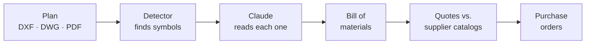
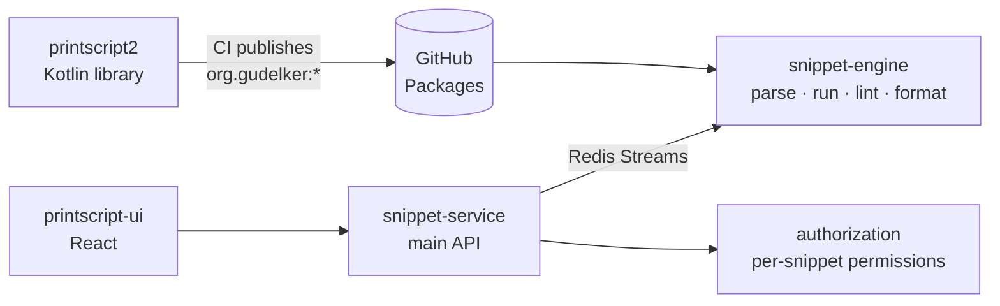

<picture>
  <source media="(prefers-color-scheme: dark)" srcset="assets/banner-dark.svg">
  
</picture>

  
  
  
  
  

I like owning a feature end to end: the Prisma schema, the NestJS or Spring service behind it, the React screen that uses it,
and the pipeline that ships it. Lately that also means putting **LLMs and computer vision** to work inside real products.
Software Engineering student at **Universidad Austral**.

<table>
  <tr>
    <td><b>Backend</b></td>
    <td></td>
  </tr>
  <tr>
    <td><b>Frontend</b></td>
    <td></td>
  </tr>
  <tr>
    <td><b>Data &amp; infra</b></td>
    <td></td>
  </tr>
  <tr>
    <td><b>Applied AI</b></td>
    <td>Claude (vision &amp; extraction) · Gemini · YOLO / RF-DETR</td>
  </tr>
</table>

## Featured work

### Lab III · electrical plans → bill of materials

Software Lab III, Universidad Austral · <b>built for a real client</b> · team of 6 · private repo · 440+ commits, 118 merged PRs

Engineers upload AutoCAD plans of electrical panels (DXF, DWG or PDF). A detector finds every symbol, an LLM reads what each
one is, and the result is a bill of materials that gets quoted against supplier catalogs and turned into purchase orders.
It replaces counting symbols by hand, which took from half an hour to a full day per panel.

<table>
  <tr>
    <td width="50%" valign="top">
      <b>Frontend</b> React
      <ul>
        <li>Auth and onboarding per role (engineer / supplier)</li>
        <li>Purchase orders module</li>
        <li>Plans dashboard and consolidated BOM with Excel/CSV export</li>
        <li>Supplier catalog panel with import history and a review queue</li>
      </ul>
    </td>
    <td width="50%" valign="top">
      <b>Backend</b> NestJS + Prisma
      <ul>
        <li>Projects module and plan processing against the detection service</li>
        <li>Quotations and the catalog matching engine</li>
        <li>Role and onboarding enforcement</li>
        <li><b>AI catalog normalizer</b>: Claude Haiku links each supplier row to a base component type, with measured cost and time</li>
      </ul>
    </td>
  </tr>
  <tr>
    <td width="50%" valign="top">
      <b>Detection service</b> Python + FastAPI
      <ul>
        <li>Started the microservice</li>
        <li>DWG → DXF conversion (LibreDWG compiled into the image)</li>
        <li>A Claude search for symbols the detector missed</li>
        <li>Gemini as a second provider, with cost comparisons</li>
      </ul>
    </td>
    <td width="50%" valign="top">
      <b>Tooling</b> GitHub Actions
      <ul>
        <li>Automated Claude PR review that reads the linked ticket and posts one structured comment</li>
      </ul>
    </td>
  </tr>
</table>

`React` `TanStack Query` `Zustand` `NestJS` `Prisma` `PostgreSQL` `FastAPI` `YOLO / RF-DETR` `Claude` `Docker` `GitHub Actions`

---

### [PrintScript + Snippet Searcher](https://github.com/grupo6-ingsis)

Ingeniería de Sistemas, Universidad Austral · team of 3 · top contributor in 3 repos

Two halves of one course: first we wrote a language, then we built a platform that runs it.
**PrintScript** is a small typed language in Kotlin (lexer, parser, AST, interpreter, formatter, configurable linter, CLI) over
a streaming pipeline; every push to `main` **publishes each module to GitHub Packages**. **Snippet Searcher** lets users write,
share, lint, format and run PrintScript snippets, and its engine depends on those published artifacts, so a new language version
reaches the app by bumping one dependency.

- **Language:** linter rules and their integration tests, formatter rules, positions in the AST, the streaming pipeline and the
  publishing tasks.
- **Platform:** main author of the snippet service (languages and versions, snippets from files, permissions, the Redis
  lint/format publishers), the Redis consumers in the engine, the Docker / nginx / Let's Encrypt infra with deploys to VMs, and
  the Cypress suite of the UI.

  
  
  
  
  

`Kotlin` `Spring Boot` `Gradle` `Redis Streams` `PostgreSQL` `Auth0` `React` `Cypress` `Docker` `nginx` `GHCR`

---

<table>
  <tr>
    <td width="50%" valign="top">
      <h3><a href="https://github.com/Bovelez/bovelez">Bovelez</a></h3>
      Aseguramiento de la Calidad de Software · team of 5 · top contributor
      
Buy and sell stocks validated against SEC EDGAR and follow the portfolio with live prices, in a project graded on how
      well it is tested: unit, integration, Cypress, Appium on Android and Locust load testing.

      <ul>
        <li>Repo, Docker setup and a <b>CI that only runs what changed</b>, plus a weekly release digest by email</li>
        <li>Backend: users, transactions, EDGAR and prices integration, S&amp;P 500 seed, hourly price batch</li>
        <li>Portfolio screens on web and most of the <b>mobile front</b></li>
        <li>The whole <b>Appium mobile e2e suite</b></li>
      </ul>
      <code>NestJS</code> <code>Prisma</code> <code>FastAPI</code> <code>React</code> <code>Cypress</code> <code>Appium</code> <code>Locust</code>
    </td>
    <td width="50%" valign="top">
      <h3>RivalMatch</h3>
      Software Lab II · team of 4 · private repo
      
Amateur teams post a rival search (sport, size, date, place), get matched with compatible teams, then chat, schedule
      and record results.

      <ul>
        <li><b>UI, top committer:</b> real-time chat over Socket.IO with notifications and read receipts, map view with Google
        Maps marker clustering, calendar, match history</li>
        <li><b>Backend:</b> Team and RivalSearch entities, the search lifecycle (expiry, active vs. matched), pagination,
        password change by email, CI</li>
      </ul>
      <code>NestJS</code> <code>Prisma</code> <code>PostgreSQL</code> <code>Socket.IO</code> <code>React</code> <code>Tailwind</code>
    </td>
  </tr>
</table>

<b>Versión en español</b>

 

Soy desarrollador **full stack con foco en backend** y estudio 4.º año de Ingeniería Informática en la **Universidad Austral**
(egreso estimado: diciembre 2027). Vivo en Pilar, Buenos Aires. Me gusta hacerme cargo de una funcionalidad de punta a punta:
el esquema, el servicio, la pantalla y el pipeline que la despliega.

- **Laboratorio III** (proyecto con un cliente real, equipo de 6, repo privado): convierte planos eléctricos de AutoCAD en
  listado de materiales, cotizaciones y órdenes de compra. Trabajé en front (onboarding, órdenes de compra, BOM, catálogo de
  proveedores), en back (proyectos, procesamiento de planos, cotización y matching, normalización de catálogos con Claude) y
  en el servicio de detección en Python.
- **[PrintScript + Snippet Searcher](https://github.com/grupo6-ingsis)** (Ingeniería de Sistemas): escribimos un lenguaje en
  Kotlin, lo publicamos como librería en GitHub Packages y lo usamos dentro de una plataforma de microservicios con Spring Boot
  y Redis Streams. Hice reglas del linter y el formatter, el servicio principal, la infraestructura y los tests de Cypress.
- **[Bovelez](https://github.com/Bovelez/bovelez)** (Aseguramiento de la Calidad de Software): tracker de acciones. Armé el
  repo y el CI, parte del back, el front mobile y toda la suite de e2e mobile con Appium.
- **RivalMatch** (Laboratorio II, repo privado): búsqueda de rivales para equipos amateurs. Chat en tiempo real, mapa y
  calendario en el front; equipos y búsquedas en el back.

