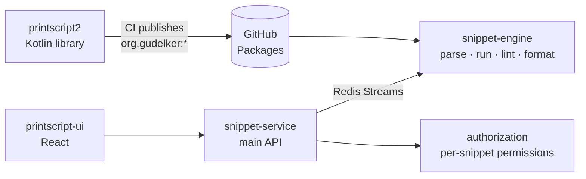

# Pedro del Aguila

**Backend-leaning full stack developer** · 4th-year Software Engineering student at **Universidad Austral** (graduating Dec 2027) · Pilar, Buenos Aires.

I like owning a feature end to end: the Prisma schema, the NestJS or Spring service behind it, the React screen that uses it, and the
pipeline that ships it. Lately that also means putting LLMs and computer vision to work inside real products.

[LinkedIn](https://www.linkedin.com/in/pedro-del-aguila/) · [delaguilapedro22@gmail.com](mailto:delaguilapedro22@gmail.com) · Spanish (native), English (C1)

---

## Projects at a glance

| Project | What it is | My part | Team |
| --- | --- | --- | --- |
| [**Lab III**](#lab-iii--electrical-plans--bill-of-materials) | Electrical plans in, bill of materials, quotes and purchase orders out | Full stack + AI service · 440+ commits, 118 merged PRs | 6 |
| [**PrintScript + Snippet Searcher**](#printscript--snippet-searcher) | Our own language, published as a library and run inside a microservices platform | Linter & formatter, main API, infra · top contributor in 3 repos | 3 |
| [**Bovelez**](#bovelez--quality-assurance) | Stock portfolio tracker built around testing | Top contributor · back, mobile front, Appium suite, CI | 5 |
| [**RivalMatch**](#rivalmatch) | Find rival teams for amateur sports and play them | Top committer on the UI · real-time chat, maps | 4 |

---

### Lab III · electrical plans → bill of materials

`Software Lab III` · `real client` · `private repo`

Engineers upload AutoCAD plans of electrical panels (DXF, DWG or PDF). A detector finds every symbol, an LLM reads what each one is, and the
result is a bill of materials that gets quoted against supplier catalogs and turned into purchase orders. It replaces counting symbols by
hand, which took from half an hour to a full day per panel.

My work splits almost evenly between back and front:

- **Frontend (React):** auth and onboarding per role (engineer / supplier), the purchase orders module, the plans dashboard and
  consolidated BOM with Excel/CSV export, and the supplier catalog panel with import history and a review queue.
- **Backend (NestJS + Prisma):** the projects module, plan processing against the detection service, quotations and the catalog
  matching engine, role and onboarding enforcement, and an **AI catalog normalizer** where Claude Haiku links each supplier row to a base
  component type, with measured cost and time.
- **Detection service (Python + FastAPI):** started the microservice, added DWG → DXF conversion (LibreDWG compiled into the image),
  a Claude search for symbols the detector missed, and Gemini as a second provider with cost comparisons.
- **Tooling:** an automated Claude PR review in GitHub Actions that reads the linked ticket and posts one structured comment.

React · TanStack Query · Zustand · NestJS · Prisma · PostgreSQL · FastAPI · YOLO / RF-DETR · Claude · Docker · GitHub Actions

---

### PrintScript + Snippet Searcher

`Ingeniería de Sistemas` · [grupo6-ingsis](https://github.com/grupo6-ingsis)

Two halves of one course: first we wrote a language, then we built a platform that runs it.

**[PrintScript](https://github.com/grupo6-ingsis/printscript2)** is a small typed language implemented in Kotlin as a multi-module Gradle
project: lexer, parser, AST, interpreter, formatter, a configurable linter and a CLI, over a streaming pipeline. Every push to `main`
bumps the version and **publishes each module to GitHub Packages** as a Maven artifact.

**Snippet Searcher** is where that library goes to work. Users write, share, lint, format and run PrintScript snippets; the
[engine](https://github.com/grupo6-ingsis/snippet-engine2) depends on the published artifacts, so a new language version reaches the app
by bumping one dependency.

- **Language:** linter rules and their integration tests, formatter rules, positions in the AST, the streaming pipeline and the
  publishing tasks.
- **Platform:** main author of [snippet-service](https://github.com/grupo6-ingsis/snippet-service2) (languages and versions, snippets
  from files, permissions, the Redis lint/format publishers), the Redis consumers in the engine, the Docker / nginx / Let's Encrypt
  [infra](https://github.com/grupo6-ingsis/infra) with deploys to VMs, and the Cypress suite of the
  [UI](https://github.com/grupo6-ingsis/printscript-ui).

Kotlin · Spring Boot · Gradle · Redis Streams · PostgreSQL · Auth0 · React · Cypress · Docker · nginx · GHCR

---

### Bovelez · quality assurance

`Aseguramiento de la Calidad de Software` · [Bovelez/bovelez](https://github.com/Bovelez/bovelez)

Buy and sell stocks validated against SEC EDGAR and follow the portfolio with live prices, in a project graded on how well it is tested:
unit, integration, Cypress, Appium on Android and Locust load testing.

- Set up the repo, the Docker setup and a **CI that only runs what changed**, plus an Action that emails a weekly release digest.
- Backend: users, the transactions module, EDGAR and prices integration, the S&P 500 seed and the hourly price batch.
- Front: the portfolio screens on web and most of the **mobile front**.
- Wrote the whole **Appium mobile e2e suite** (auth, portfolio, stock, watchlist, overselling edge cases).

NestJS · Prisma · FastAPI · React · Cypress · Appium · Locust · GitHub Actions · semantic-release

---

### RivalMatch

`Software Lab II` · `private repo`

Amateur teams post a rival search (sport, size, date, place), get matched with compatible teams, then chat, schedule and record results.

- **UI (top committer):** real-time chat over Socket.IO with notifications and read receipts, the map view with Google Maps marker
  clustering, the calendar, "my matches" and match history.
- **Backend:** the Team and RivalSearch entities and the search lifecycle (expiry, active vs. matched), pagination, password change
  confirmation by email, and the CI workflow.

NestJS · Prisma · PostgreSQL · Socket.IO · React · Tailwind · Google Maps

---

<b>Versión en español</b>

 

Soy desarrollador **full stack con foco en backend** y estudio 4.º año de Ingeniería Informática en la **Universidad Austral** (egreso estimado: diciembre 2027). Vivo en Pilar, Buenos Aires. Me
gusta hacerme cargo de una funcionalidad de punta a punta: el esquema, el servicio, la pantalla y el pipeline que la despliega.

- **Laboratorio III** (cliente real, repo privado): convierte planos eléctricos de AutoCAD en listado de materiales, cotizaciones
  y órdenes de compra. Trabajé en front (onboarding, órdenes de compra, BOM, catálogo de proveedores), en back (proyectos, procesamiento
  de planos, cotización y matching, normalización de catálogos con Claude) y en el servicio de detección en Python.
- **PrintScript + Snippet Searcher** (Ingeniería de Sistemas): escribimos un lenguaje en Kotlin, lo publicamos como librería en GitHub
  Packages y lo usamos dentro de una plataforma de microservicios con Spring Boot y Redis Streams. Hice reglas del linter y el
  formatter, el servicio principal, la infraestructura y los tests de Cypress.
- **[Bovelez](https://github.com/Bovelez/bovelez)** (Aseguramiento de la Calidad de Software): tracker de acciones. Armé el repo y el CI,
  parte del back, el front mobile y toda la suite de e2e mobile con Appium.
- **RivalMatch** (Laboratorio II, repo privado): búsqueda de rivales para equipos amateurs. Chat en tiempo real, mapa y calendario en el
  front; equipos y búsquedas en el back.

