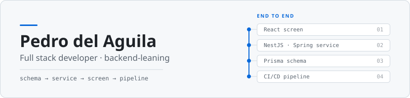
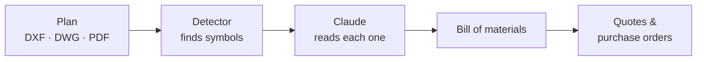
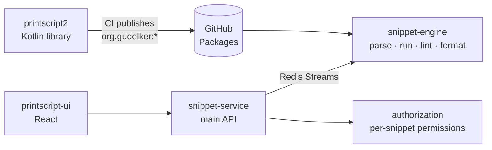
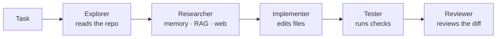

<picture>
  <source media="(prefers-color-scheme: dark)" srcset="assets/banner-dark.svg">
  
</picture>

  
  

  <a href="#about">About</a> ·
  <a href="#technical-skills">Technical skills</a> ·
  <a href="#projects">Projects</a> ·
  <a href="#project-details">Project details</a> ·
  <a href="#versión-en-español">Español</a>

## About

I like owning a feature end to end: the Prisma schema, the NestJS or Spring service behind it, the React screen that uses it,
and the pipeline that ships it. Lately that also means putting **LLMs and computer vision** to work inside real products.

<table>
  <tr>
    <td><b>Education</b></td>
    <td>Universidad Austral · 4th year · graduating Dec 2027</td>
  </tr>
  <tr>
    <td><b>Location</b></td>
    <td>Pilar, Buenos Aires</td>
  </tr>
  <tr>
    <td><b>Languages</b></td>
    <td>Spanish (native) · English (C1)</td>
  </tr>
</table>

## Technical skills

<table>
  <tr>
    <td width="140"><b>Backend</b></td>
    <td></td>
  </tr>
  <tr>
    <td><b>Frontend</b></td>
    <td></td>
  </tr>
  <tr>
    <td><b>Data &amp; infra</b></td>
    <td></td>
  </tr>
  <tr>
    <td><b>Applied AI</b></td>
    <td>Claude (vision &amp; extraction) · Gemini · YOLO / RF-DETR</td>
  </tr>
</table>

## Projects

<table>
  <thead>
    <tr>
      <th align="left" width="24%">Project</th>
      <th align="left" width="38%">Summary</th>
      <th align="left" width="38%">My part</th>
    </tr>
  </thead>
  <tr>
    <td valign="top">
      <b><a href="#lab-iii">Lab III</a></b> 
      Software Lab III · <b>real client</b> · team of 6 
      Private repo
    </td>
    <td valign="top">AutoCAD electrical plans in; bill of materials, supplier quotes and purchase orders out.</td>
    <td valign="top">Full stack + the AI detection service · 440+ commits, 118 merged PRs</td>
  </tr>
  <tr>
    <td valign="top">
      <b><a href="#printscript--snippet-searcher">PrintScript + Snippet Searcher</a></b> 
      Ingeniería de Sistemas · team of 3 
      <a href="https://github.com/grupo6-ingsis">grupo6-ingsis</a>
    </td>
    <td valign="top">A language of our own, published as a Kotlin library and run inside a microservices platform.</td>
    <td valign="top">Linter &amp; formatter, the main API, infra · top contributor in 3 repos</td>
  </tr>
  <tr>
    <td valign="top">
      <b><a href="#bovelez">Bovelez</a></b> 
      Aseguramiento de la Calidad de Software · team of 5 
      <a href="https://github.com/Bovelez/bovelez">Bovelez/bovelez</a>
    </td>
    <td valign="top">Stock portfolio tracker built around testing: unit, integration, Cypress, Appium and Locust.</td>
    <td valign="top">Top contributor · backend, mobile front, the Appium suite and CI</td>
  </tr>
  <tr>
    <td valign="top">
      <b><a href="#rivalmatch">RivalMatch</a></b> 
      Software Lab II · team of 4 
      Private repos
    </td>
    <td valign="top">Amateur teams find a rival, get matched, then chat, schedule and record the result.</td>
    <td valign="top">Top committer on the UI · real-time chat, maps · search lifecycle in the back</td>
  </tr>
  <tr>
    <td valign="top">
      <b><a href="#coding-agent">Coding Agent</a></b> 
      Inteligencia Artificial · final project · team of 3 
      <a href="https://github.com/Agustinguglielmelli/coding-agent">Agustinguglielmelli/coding-agent</a>
    </td>
    <td valign="top">A coding agent that plans, implements and validates changes in a NestJS repo, alone or as a chain of 5 subagents.</td>
    <td valign="top">Local RAG, persistent memory, the first multi-agent version, Langfuse tracing</td>
  </tr>
</table>

## Project details

### Lab III

**Electrical plans → bill of materials**

<table>
  <tr><td width="140"><b>Course</b></td><td>Software Lab III, Universidad Austral</td></tr>
  <tr><td><b>Client</b></td><td>Built for a real client</td></tr>
  <tr><td><b>Team</b></td><td>6</td></tr>
  <tr><td><b>Repository</b></td><td></td></tr>
  <tr><td><b>Stack</b></td><td><code>React</code> <code>TanStack Query</code> <code>Zustand</code> <code>NestJS</code> <code>Prisma</code> <code>PostgreSQL</code> <code>FastAPI</code> <code>YOLO / RF-DETR</code> <code>Claude</code> <code>Docker</code> <code>GitHub Actions</code></td></tr>
</table>

Engineers upload AutoCAD plans of electrical panels (DXF, DWG or PDF). A detector finds every symbol, an LLM reads what each
one is, and the result is a bill of materials that gets quoted against supplier catalogs and turned into purchase orders.
It replaces counting symbols by hand, which took from half an hour to a full day per panel.

<table>
  <tr>
    <td width="50%" valign="top">
      <b>Frontend</b> · React
      <ul>
        <li>Auth and onboarding per role (engineer / supplier)</li>
        <li>Purchase orders module</li>
        <li>Plans dashboard and consolidated BOM with Excel/CSV export</li>
        <li>Supplier catalog panel with import history and a review queue</li>
      </ul>
    </td>
    <td width="50%" valign="top">
      <b>Backend</b> · NestJS + Prisma
      <ul>
        <li>Projects module and plan processing against the detection service</li>
        <li>Quotations and the catalog matching engine</li>
        <li>Role and onboarding enforcement</li>
        <li><b>AI catalog normalizer</b>: Claude Haiku links each supplier row to a base component type, with measured cost and time</li>
      </ul>
    </td>
  </tr>
  <tr>
    <td width="50%" valign="top">
      <b>Detection service</b> · Python + FastAPI
      <ul>
        <li>Started the microservice</li>
        <li>DWG → DXF conversion (LibreDWG compiled into the image)</li>
        <li>A Claude search for symbols the detector missed</li>
        <li>Gemini as a second provider, with cost comparisons</li>
      </ul>
    </td>
    <td width="50%" valign="top">
      <b>Tooling</b> · GitHub Actions
      <ul>
        <li>Automated Claude PR review that reads the linked ticket and posts one structured comment</li>
      </ul>
    </td>
  </tr>
</table>

<a href="#projects">↑ Back to projects</a>

### PrintScript + Snippet Searcher

**A language and the platform that runs it**

<table>
  <tr><td width="140"><b>Course</b></td><td>Ingeniería de Sistemas, Universidad Austral</td></tr>
  <tr><td><b>Team</b></td><td>3</td></tr>
  <tr><td><b>Organization</b></td><td></td></tr>
  <tr><td><b>Stack</b></td><td><code>Kotlin</code> <code>Spring Boot</code> <code>Gradle</code> <code>Redis Streams</code> <code>PostgreSQL</code> <code>Auth0</code> <code>React</code> <code>Cypress</code> <code>Docker</code> <code>nginx</code> <code>GHCR</code></td></tr>
</table>

Two halves of one course: first we wrote a language, then we built a platform that runs it. **PrintScript** is a small typed
language in Kotlin (lexer, parser, AST, interpreter, formatter, configurable linter, CLI) over a streaming pipeline; every push to
`main` **publishes each module to GitHub Packages**. **Snippet Searcher** lets users write, share, lint, format and run PrintScript
snippets, and its engine depends on those published artifacts, so a new language version reaches the app by bumping one dependency.

<table>
  <tr>
    <td width="50%" valign="top">
      <b>The language</b> · Kotlin + Gradle
      <ul>
        <li>Linter rules and their integration tests</li>
        <li>Formatter rules</li>
        <li>Positions in the AST</li>
        <li>The streaming pipeline and the publishing tasks</li>
      </ul>
    </td>
    <td width="50%" valign="top">
      <b>The platform</b> · Spring Boot + Redis Streams
      <ul>
        <li>Main author of the snippet service: languages and versions, snippets from files, permissions, the Redis lint/format publishers</li>
        <li>The Redis consumers in the engine</li>
        <li>Docker / nginx / Let's Encrypt infra with deploys to VMs</li>
        <li>The Cypress suite of the UI</li>
      </ul>
    </td>
  </tr>
</table>

  
  
  
  
  

<a href="#projects">↑ Back to projects</a>

### Bovelez

**Stock portfolio tracker, graded on its tests**

<table>
  <tr><td width="140"><b>Course</b></td><td>Aseguramiento de la Calidad de Software, Universidad Austral</td></tr>
  <tr><td><b>Team</b></td><td>5</td></tr>
  <tr><td><b>Repository</b></td><td></td></tr>
  <tr><td><b>Stack</b></td><td><code>NestJS</code> <code>Prisma</code> <code>FastAPI</code> <code>React</code> <code>Cypress</code> <code>Appium</code> <code>Locust</code> <code>GitHub Actions</code> <code>semantic-release</code></td></tr>
</table>

Buy and sell stocks validated against SEC EDGAR and follow the portfolio with live prices, in a project graded on how well it is
tested: unit, integration, Cypress, Appium on Android and Locust load testing.

<table>
  <tr>
    <td width="33%" valign="top">
      <b>Backend</b> · NestJS + FastAPI
      <ul>
        <li>Users and the transactions module</li>
        <li>EDGAR and prices integration</li>
        <li>S&amp;P 500 seed and the hourly price batch</li>
      </ul>
    </td>
    <td width="33%" valign="top">
      <b>Front &amp; QA</b> · React + Appium
      <ul>
        <li>Portfolio screens on web</li>
        <li>Most of the <b>mobile front</b></li>
        <li>The whole <b>Appium mobile e2e suite</b>: auth, portfolio, stock, watchlist, overselling</li>
      </ul>
    </td>
    <td width="33%" valign="top">
      <b>Repo &amp; CI</b> · GitHub Actions
      <ul>
        <li>Repo and Docker setup</li>
        <li>A <b>CI that only runs what changed</b></li>
        <li>A weekly release digest by email</li>
      </ul>
    </td>
  </tr>
</table>

<a href="#projects">↑ Back to projects</a>

### RivalMatch

**Find a rival team and play them**

<table>
  <tr><td width="140"><b>Course</b></td><td>Software Lab II, Universidad Austral</td></tr>
  <tr><td><b>Team</b></td><td>4</td></tr>
  <tr><td><b>Repositories</b></td><td> </td></tr>
  <tr><td><b>Stack</b></td><td><code>NestJS</code> <code>Prisma</code> <code>PostgreSQL</code> <code>Socket.IO</code> <code>React</code> <code>Tailwind</code> <code>Google Maps</code></td></tr>
</table>

Amateur teams post a rival search (sport, size, date, place), get matched with compatible teams, then chat, schedule and record
results.

<table>
  <tr>
    <td width="50%" valign="top">
      <b>Front · rivalmatch-ui</b> · React + Tailwind · <b>top committer</b>
      <ul>
        <li>Real-time chat over Socket.IO with notifications and read receipts</li>
        <li>Map view with Google Maps marker clustering</li>
        <li>Calendar, "my matches" and match history</li>
      </ul>
    </td>
    <td width="50%" valign="top">
      <b>Back · rivalmatch-back</b> · NestJS + Prisma
      <ul>
        <li>Team and RivalSearch entities</li>
        <li>The search lifecycle: expiry, active vs. matched</li>
        <li>Pagination, password change confirmed by email, the CI workflow</li>
      </ul>
    </td>
  </tr>
</table>

<a href="#projects">↑ Back to projects</a>

### Coding Agent

**An agent that writes code in a real repo**

<table>
  <tr><td width="140"><b>Course</b></td><td>Inteligencia Artificial, Universidad Austral · final project</td></tr>
  <tr><td><b>Team</b></td><td>3</td></tr>
  <tr><td><b>Repository</b></td><td></td></tr>
  <tr><td><b>Stack</b></td><td><code>Node.js</code> <code>OpenAI</code> <code>Gemini</code> <code>RAG</code> <code>Multi-agent</code> <code>Langfuse</code> <code>OpenTelemetry</code> <code>Tavily</code></td></tr>
</table>

A coding agent in Node.js, with no orchestration framework, pointed at the RivalMatch backend (NestJS). It plans a task, asks for
approval, then works alone or as a chain of five subagents, each with only the permissions its step needs. It reads and writes
files and runs commands under read, write and command policies, with human approval for the sensitive ones. It runs on OpenAI or Gemini.

<table>
  <tr>
    <td width="50%" valign="top">
      <b>Context</b> · RAG + memory
      <ul>
        <li>The <b>local RAG</b>: chunking, embeddings and similarity search over the project's docs</li>
        <li><b>Persistent project memory</b>: architecture, conventions and decisions kept between sessions</li>
        <li>The agent configuration, and a workspace set by env so it can work on any repo</li>
      </ul>
    </td>
    <td width="50%" valign="top">
      <b>Agents &amp; observability</b> · Node.js + Langfuse
      <ul>
        <li>The <b>first version of the multi-agent mode</b> and the five-subagent task</li>
        <li>The OpenAI client used to test it</li>
        <li><b>Langfuse / OpenTelemetry traces</b> per subagent and per tool call</li>
      </ul>
    </td>
  </tr>
</table>

<a href="#projects">↑ Back to projects</a>

---

## Versión en español

<b>Ver resumen en español</b>

 

Soy desarrollador **full stack con foco en backend** y estudio 4.º año de Ingeniería Informática en la **Universidad Austral**
(egreso estimado: diciembre 2027). Vivo en Pilar, Buenos Aires. Me gusta hacerme cargo de una funcionalidad de punta a punta:
el esquema, el servicio, la pantalla y el pipeline que la despliega.

- **[Laboratorio III](#lab-iii)** (proyecto con un cliente real, equipo de 6, repo privado): convierte planos eléctricos de
  AutoCAD en listado de materiales, cotizaciones y órdenes de compra. Trabajé en front (onboarding, órdenes de compra, BOM,
  catálogo de proveedores), en back (proyectos, procesamiento de planos, cotización y matching, normalización de catálogos con
  Claude) y en el servicio de detección en Python.
- **[PrintScript + Snippet Searcher](https://github.com/grupo6-ingsis)** (Ingeniería de Sistemas, equipo de 3): escribimos un
  lenguaje en Kotlin, lo publicamos como librería en GitHub Packages y lo usamos dentro de una plataforma de microservicios con
  Spring Boot y Redis Streams. Hice reglas del linter y el formatter, el servicio principal, la infraestructura y los tests de Cypress.
- **[Bovelez](https://github.com/Bovelez/bovelez)** (Aseguramiento de la Calidad de Software, equipo de 5): tracker de acciones.
  Armé el repo y el CI, parte del back, el front mobile y toda la suite de e2e mobile con Appium.
- **[RivalMatch](#rivalmatch)** (Laboratorio II, equipo de 4, repos privados de front y back): búsqueda de rivales para equipos
  amateurs. Chat en tiempo real, mapa y calendario en el front; equipos y ciclo de vida de las búsquedas en el back.
- **[Coding Agent](https://github.com/Agustinguglielmelli/coding-agent)** (trabajo final de Inteligencia Artificial, equipo de 3):
  un agente de código en Node.js que planifica, implementa y valida cambios en el backend de RivalMatch, solo o con cinco
  subagentes. Hice el RAG local, la memoria persistente del proyecto, la primera versión del modo multiagente y las trazas con Langfuse.

